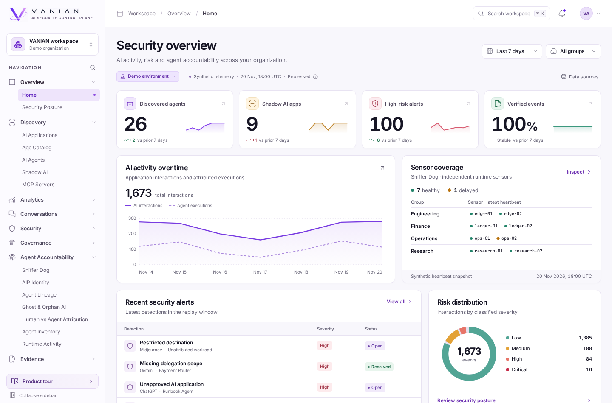

# VANIAN AI Security Control Plane

An enterprise evaluation console built with Next.js-compatible Vinext, React, TypeScript, TanStack Table and Query, ECharts, React Flow, Three.js and Cloudflare D1. VANIAN’s uploaded orbital mark and wordmark are displayed from the original image.

## Start an evaluation

Open Home in the demo environment. Select a KPI, filter by group or time, open an alert and follow its timeline to the linked evidence batch. Use **Verification → Research archive verification** to run the original VANIAN observer or AIP evaluator locally in a browser worker. The four retained cases are historical lab captures. The dashboard metrics come from a separately identified synthetic tenant.

[View the running console screens](design-review/README.md) · [Reproduce the AIP verification](bridge/IMPLEMENTATION.md)



## Run from source

Use Node 22.13 or newer. Install the project’s locked dependency graph, build the Worker, initialize the evaluation database and start it.

```sh
npm ci
npm run build
npm run db:local
npm run start
```

The start command prints the local URL. For development, run `npm run dev` after initializing the database. The prebuilt original verifier modules and their public test inputs ship with the source. The native observer toolchain is required only when rebuilding those modules or connecting a customer-side reader.

`npm run db:local` tracks local migration names and applies pending migrations once. Hosted Sites provisions the declared DB binding and applies tracked migrations when publishing. For an independent deployment, provision the equivalent Worker, D1 binding, identity proxy and HTTPS service connection. Restrict direct origin access and strip client-supplied identity headers before the identity proxy injects verified claims.

## Data and authority

| Source | Implemented behavior | Evaluation boundary |
| --- | --- | --- |
| Synthetic tenant | 63 days of deterministic activity, server-side aggregation, discovery, redacted forensics, investigation notes, policies, simulation, budget allocation and control mappings | The snapshot ends on 20 November 2026 at 18:00 UTC. Simulated decisions perform no external enforcement. Policy changes affect subsequent simulations. Historical decisions retain the original version. |
| Demo signature verifier | Checks SHA-256 and Ed25519 over signed fixture batches, exports payloads and validates them offline | A fixture signature authenticates demo bytes under the published evaluation key. |
| Upstream research archive | The compiled original Rust observer and AIP evaluator run against pinned captures in the browser | Verified integrity, process observations, declared authority, sensor coverage and business-action verdicts have distinct fields. |
| Customer-side native reader | The authorized console calls a tenant-bound HTTPS adapter. The adapter snapshots customer files and runs the original operator-provisioned binaries against independently configured trust anchors | Supported reads expose observation records, directly evidenced process edges, signed archive summaries and optional AIP reconciliation records. A file reader reports the sensor connection as offline. |
| Commercial controls | Administration shows configured capabilities and qualification status | Enterprise SSO/SCIM provisioning, subscription collection, independent security review, continuous production sensing and production enforcement need customer-side integration and acceptance. |

All live reads use the same-origin API and enforce authenticated membership on the server. A failed live read returns an error. Demo role switching applies only inside the synthetic evaluation tenant. Hosted private access uses the platform sign-in boundary. Evaluation sessions use HttpOnly secure cookies. A signed-in visitor’s demo edits are held in an isolated tenant; anonymous local evaluations receive isolated browser tenants. Administrators configure policies, analysts manage cases and auditors read reports. Original synthetic content requires an explicit, audited administrator reveal. Live prompt and response text is conservatively redacted at the console boundary.

## Connect a customer archive

1. Review the pinned upstream interfaces, trust assumptions, native build and reproduction instructions in `bridge/IMPLEMENTATION.md`.
2. On the customer host, install `aip-observe-verify` and, where needed, `aip-execution-assurance`. Configure regular archive files plus independently enrolled public trust anchors using `bridge/service.config.example.json`. Bind the reader to loopback and expose it through an authenticated, operator-managed HTTPS endpoint.
3. Configure a matching tenant, subject and role at both ends. Set `VANIAN_BRIDGE_TOKEN` on the reader and the same credential as `VANIAN_API_TOKEN` in the hosting secret store. Set `VANIAN_API_ORIGIN` and `VANIAN_LIVE_MEMBERS` on the console. The membership value maps the platform-supplied site-scoped user ID to an object such as `{"tenant":"customer-id","role":"Analyst"}`. The front end never receives the token or membership map.
4. Switch to Live. Open Home, Security Posture, Sniffer Dog, Runtime Activity, Agent Lineage, Attribution, AIP Identity, Execution Evidence or Verification. The reader responds only for supported, authenticated data. Customer-side archive verification runs before a verified status is returned.
5. In Sniffer Dog, select **Follow archive updates** to subscribe to changes over an authenticated server-sent event connection. The reader rechecks completed files every five seconds. The feed reports file changes even when the originating sensor is offline.
6. Inspect the source, attestation timestamp and verification time. Select a record and export the permitted redacted projection. Current end-to-end API and TLS tests use locally generated process samples and ephemeral trust anchors.

## API contract

`src/navigation.ts` maps each route to its role and API resource. `src/types.ts` defines the response envelope. `src/server/live.ts` validates the live boundary. A successful list includes provenance, scoped rows, total count and pagination. Read parameters include `mode`, `days`, `group`, `q`, `sort`, `dir`, `page`, `size`, `id` and view-specific facets. Writes return consistent error codes with messages. Editor writes use record revisions and audit logging.

The console’s `/api/*` routes belong to this application. The customer-side `/v1/*` reader adapts the upstream native file/CLI interfaces. Upstream authority, trust-floor and observer semantics are preserved. The synthetic fixture signature format is documented by `src/server/proof.ts`. Verify an exported demo batch independently with:

```sh
node scripts/verify-export.mjs downloaded-batch.json
```

The verifier uses the pinned evaluation key in the project, or an independently supplied public JWK as a second argument.

## Verification

On Linux, follow the [toolchain setup](bridge/IMPLEMENTATION.md) and run the complete gate from the console directory.

```sh
npm run verify:aip-console
```

The gate builds the Worker, checks types and runs the native, adapter and browser tests. A missing prerequisite or a skipped case fails the gate. Tests cover tenant isolation, role restrictions, persistence, redaction, desktop and phone workflows, and the upstream evidence verifier. The [component workbench](design-review/README.md) also exercises the verified, changed-byte and empty-scope states in isolation.

## V3 workspace coverage

| Product workspace | Evaluation workflow | Customer connection supplied here |
| --- | --- | --- |
| Enterprise overview | Scope KPIs by date and group, open the matching records and inspect provenance | Native reader aggregates signed process samples, kernel events and unbound observations across eligible records in the archive |
| Application discovery and Shadow AI | Explore applications and domains, classify risk, review approval and inspect usage | Discovery connector required |
| Agent inventory | Filter registrations and unknown candidates, inspect owners, workloads and delegated permissions | Agent registry connector required |
| MCP server and tool governance | Inspect server inventory, tools, schemas and policy scope | MCP gateway and call records required |
| Conversation explorer | Search, filter and investigate role-masked interactions | Conversation source required |
| Behavioral intelligence | Explore guardrail and adoption views, compare periods and export events | Backend aggregations required |
| Alerts and investigations | Assign cases, change status, add notes and follow evidence | Case-management and detection sources required |
| Enterprise policies | Edit, reorder, simulate, approve, duplicate and roll back versioned policies | Production decision and enforcement connectors required |
| Runtime protection | Review classified detections and simulated decisions | Process observations supported by the reader. Prevention requires a separate enforcing integration |
| Sniffer Dog | Replay traces, inspect topology, sensor health, unattributed activity and references | Reads new signed archives through the native observer and publishes changes to the open console |
| Agent lineage | Search, pan, select, expand and export 2D or 3D graph records | Native observer can establish process edges. Logical agent lineage needs trusted binding evidence |
| Ghost and orphan investigations | Evaluate ownership gaps and unbound execution candidates using confidence labels | Requires enrolled identity, ownership and execution sources |
| AIP identity and attribution | Inspect authority records, limits and attributable executions | Reads trusted run bundles through the original AIP evaluator |
| Cryptographic evidence and audit | Verify original lab captures and exported synthetic batches, inspect audit history | Customer reader checks signed observer archives and exposes evidence metadata |
| AI FinOps | Inspect metered and estimated inputs, set budgets and compare projected routing cost | Billing and token-usage connectors required |
| AI red teaming | Run benign, predefined policy regression cases and inspect result histories | Production assessment and active tests require separate qualification |
| Compliance and governance | View control mappings, evidence, owners and exceptions and export reports | Customer-specific mapping and independent assessment required |
| Enterprise administration | Inspect deployment, retention, permissions, SSO, integration and commercial status | Private hosting and server-side membership checks available. Customer SSO, SCIM, billing and operational qualification remain open |

## Release scope

This release supports a supervised evaluation of discovery, agent identity, observation, lineage, investigation and evidence. The remaining commercial screens provide bounded evaluation workflows and connector status. Before customer production use, validate identity-provider configuration, sensor coverage and overhead under representative load, institutional trust anchors and key rotation, disaster recovery, retention, supported deployment topology, support obligations and independent security testing.
