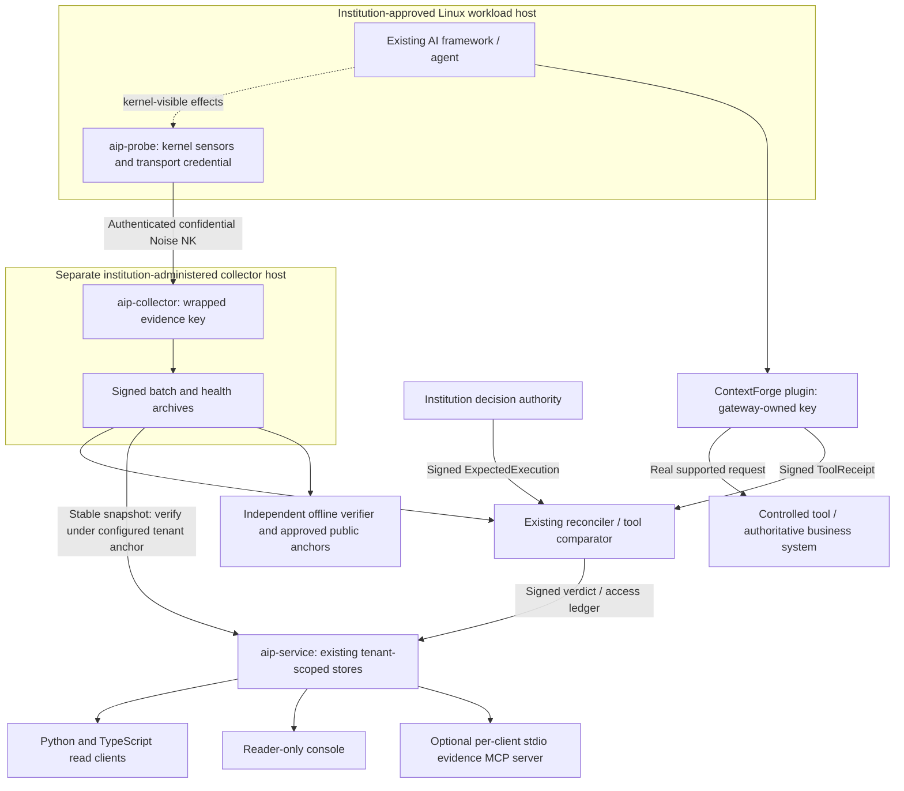

# VANIAN enterprise evaluation architecture

Implementation base: `3a029aec83fa2aa57ea8bb0a2c28968f3be037a4`.
It contains RBI preflight `0991fb1eed1234403c1ff9683d010797ea073d39`
and the signed placement-attribution work. This branch extends those systems;
it does not change any signed protocol encoding.

The diagram's deployment boundary is a requirement, not a result of drawing
two containers. Local tests establish software interfaces, not separate
administration or an uncompromised kernel. The collector key never belongs on
the probe/agent host. A transport credential is not an evidence-signing key.
Gateway, decision-point, collector, agent and export-service signing
authorities remain distinct.

## Implemented paths and their limits

The probe and collector run without the SDK, gateway plugin or evidence MCP
server. `aip-transport` authenticates enrolled probes and pins the collector's
Noise key. `aip-collector` signs and durably archives observations/health and
preserves continuity; it cannot invent events lost during downtime.

The actual ContextForge plugin uses its pinned `cpex.framework.Plugin`
pre/post hooks. Rust owns canonicalization, domain separation, signatures and
tool-boundary comparison. The gateway's receipt describes the actual request
and disposition; even a Forwarded receipt is not proof that a banking
transaction completed. A missing decision ID is refused for this enrolled tool
profile. A present ID is only a join label until compared with separately
verified authorization.

`POST /v1/observations` admits bounded archive snapshots only under
institution-provisioned tenant/observer/version public anchors. Stored
archives retain the original signed strings. Read-side verification calls
the same `aip-observe-verify` core as the offline CLI. It states historical
signature integrity, not current coverage, physical key separation or an
authorization/execution join. Separate snapshots are not silently joined into
a continuous history.

The API preserves `/v1` and the existing stores; no second database or agent
identity model was introduced. Packet inventory is explicitly agent-signed
metadata. Collector archives and reconciler verdicts are separate artifact
kinds. A stored verdict is not converted into a new service judgment.
Consumers must approve their own reconciler trust anchors: the legacy verdict
submission endpoint verifies under submitter-supplied anchors.

The optional MCP server is **stdio only**, one OS-owned process per
institutional client. It verifies that its configured service token is
Reader and remains bound to the same tenant on every call. It has eight
allowlisted read tools; no shell, arbitrary HTTP URL, signing, raw export or
collector administration tool exists. There is no HTTP MCP listener or Origin
surface. A shared remote MCP transport/OAuth deployment remains unimplemented.

## Deployment options

The evaluation package supports role-separated systemd installation after
approved Linux preflight. Its Helm deployment is disabled by default and is
an unvalidated template. The air-gap procedure bundles reviewed binaries,
dependencies, manifests and institution-controlled trust anchors; no online
VANIAN service is required by the offline verifier. See the [inventory](INVENTORY.md)
and [readiness report](PRODUCT_READINESS.md) before selecting an option.
