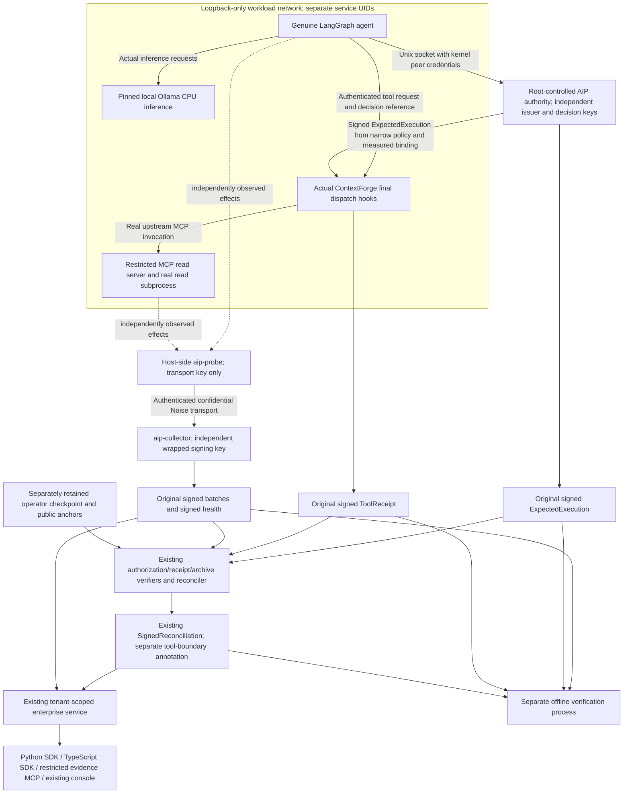

# Same-run execution assurance integration

## 2026-11-02 update — runtime source `3e6c179`

**Assignment status: PARTIAL; engineering validation, with acceptance gates still open.**
This dated section is the current snapshot at
`3e6c1794000fa23006ef623722e37700e49582b7`. The historical text after the divider
is preserved unchanged; its references to “current” describe its own recorded
source and date. Keep PRs #6, #7 and #8 in draft until the remaining criteria
are satisfied.

The implemented composition now includes the optional reviewed
[open-source governance integration](OPEN_SOURCE_GOVERNANCE.md), enabled by
`governance_stack=true` in the existing same-run workflow. It extends the
existing agent → Unix broker → AIP authority → ContextForge → tool → Sniffer
Dog → existing verifier/API/SDK/MCP/console path; it adds no replacement agent
identity, receipt, signing or evidence protocol.

OPA evaluates the actual controller-measured peer and permitted read scope
before the existing AIP signer. Its decision, policy hash and decision-ID link
are unsigned controller application records; an allow result cannot bypass
the unchanged signer or signature/receipt/reconciliation rules. OpenTelemetry
exports a delayed batch of controller-operation timestamps and approved IDs,
hashes and status fields after workload cleanup. It does not create model
spans, signed kernel evidence or an authorization authority. The Collector is
stopped and reaped before complete final-file verification. Only the original
verified `records.json`, `collector-config.json`, `collector-spans.jsonl` and
`telemetry-report.json` are published from its private staging area; raw
Collector logs and failed/unvalidated output remain private. Unknown fields,
duplicate JSON keys, extra tails, wrong correlations or timestamps refuse
publication.

The OPA input's PID/UID/GID come from the actual kernel peer boundary in the
genuine controller path. The agent does not choose trusted identity, policy
allowlists or signing keys. Component peer inputs are explicit fixtures and
do not by themselves establish that boundary. The SDK uses its own pinned
Python environment; the agent, gateway and evidence-client dependencies are
not replaced. The local Collector accepts loopback OTLP/HTTP and exports only
to its local file. Remote customer backends, TLS/authentication deployment and
institution-controlled trace retention are unvalidated.

The actual OPA 1.22.0 + isolated OpenTelemetry SDK 1.45.2 + Collector Contrib
0.164.0 component gate passed on Mac and GitHub-hosted Linux: **21 tests, zero
failures, errors or skips**. Linux run
[41432496211](https://github.com/richardrich999888-rgb/AIP-agent-identity-protocol-/actions/runs/41432496211),
job `125234256123`, ran the real engines. Controlled policy/peer fixtures and
component timestamp fixtures are not evidence of agent behavior or actual
operating-system peer measurement. The genuine `GovernanceRun` records its
own actual operation boundaries. See the
[component proof](../../validation/enterprise/results/GOVERNANCE_20261102/components-3e6c179/source-index.json)
and [scope statement](../../validation/enterprise/results/GOVERNANCE_20261102/SCOPE.md).

Governance-enabled Linux run `41432473155` at this source passed missing-assets
refusal, positive execution, genuine interruption, fresh recovery and all
enterprise clients. Artifact `13136100222` has service SHA256
`48ccc9525cade552b8eb28874e0c786b96a4b00024defd8b17e7cd9fbab6a505`.
**Independent replay of all three new bundles: PASS.** The
[original inventory and separate replay](../../validation/enterprise/results/GOVERNANCE_20261102/genuine-3e6c179/preservation-index.json) preserve the exact 154-member
ZIP, AIP records, OPA links and final six-phase Collector files. The independently passing 1968 three-profile baseline
remains separate. This engineering connection supports the pitch “policy before
authorization, observed activity, offline-verifiable evidence and operational
trace references,” subject to each evidence layer's actual result.

The complete 18-check component/security suite at runtime source `3e6c179`
finished **16 PASS / 2 FAIL**. The separate genuine core workflow passed; its
guarded PR Agent Zero task was skipped. [Exact CI provenance and counts](../../validation/enterprise/results/GOVERNANCE_20261102/ci-3e6c179/registry.json)
retain every skipped/ignored or blocked scope separately. Gitleaks still reports
217 findings and Trivy four HIGH findings in the historical enabled Helm
render. Their result objects match the retained previously reviewed records;
no detector result is waived or rewritten. Cargo audits retain the inherited
`RUSTSEC-2026-0097` exception documented in `deny.toml`; no new exception was
added, and an audit pass is not an unqualified security clearance.

Independent administration still requires a separately controlled Linux
workload host and collector Linux host/trust domain, approved public anchors,
collector signing-key custody and durable retention. One disposable runner's
root/kernel/GitHub administration remains trusted. Actual installed fanotify
service qualification, installer/startup/restart/uninstall and recovery,
logical sub-agent delegation, concurrency/soak and matched overhead,
institutional key/identity operations, customer deployment and regulatory
acceptance remain unvalidated. Remote-model credentials and protected
production telemetry endpoints are configuration gates if those routes are
selected; public local inference and the completed local component checks do
not require those secrets.

## Historical record preserved below

The following text is retained unchanged from its recorded historical revision.

The integration branch combines PR #6 at `65b6ff7fdad5ae70546a57216a497399091c7dc7`
and PR #7 at `bd15b8e627e5ef67ba259559ed81feb6894cde48`. Their common ancestor
is `f025a57911f7daf473cdfdcbf98d2f911df2534e`. Merge revision
`e3aa195def7524d6ec84d37a934beebe18b6c794` contains both sets of changes.
The subsequent integration wrappers reuse the existing signed record formats.

The implemented first-run topology uses one disposable Linux VM. Different OS
accounts and private directories isolate the model, agent, gateway and tool
from authority, collector and reconciler keys. All still trust the VM kernel,
host root and GitHub administration. Separate institutional custody remains a
separate acceptance gate. The enterprise two-host installer retains its stricter
separation requirement.

`aip_mcp_gateway::assurance` joins original records under public anchors loaded
outside the submitted bundle. It invokes the existing authorization verifier,
`verify_tool_receipt`, archive verifier, `reconcile_expectation` and
`compare_tool_boundary`. It verifies optional original signed reconciliation
against the configured reconciler key and exact canonical recomputation.
It introduces no replacement signature or execution-verdict protocol.

The authority measures the actual ready agent process through host procfs,
checks binding stability, verifies issuer scope and checks an exact canonical
tool/resource/parameter policy. The agent supplies neither PID nor keys to the
Unix broker. The gateway independently checks the stored signed authorization
against its authenticated principal, actual received parameters and timestamp.
A random correlation ID cannot satisfy this path.

The same-run API stores the original bundle bytes and reevaluates them under
server-configured tenant/agent anchors and retained archive digests. Reader
credentials cannot submit or retrieve raw bundles. Existing evidence MCP tools
expose bounded metadata, evaluations and verified verdicts, with no additional
signing, shell, export or observer-control privilege.

The kernel cannot directly establish `ghost.tool.invoke.v1` business semantics
or in-process logical-agent identity. A truthful result may have verified
request-document agreement and a kernel `CannotProve` finding. File-write,
process and network records retain their individual process-instance bindings;
a tool-server child is not relabeled as the agent interpreter. A read-only
SQLite result is tool testimony and inspectable test output; fanotify does not
supply a file-read proof. See [SECURITY_ACCEPTANCE.md](SECURITY_ACCEPTANCE.md).

## Artifact origins and trust limits

This register describes evidence types, not passing execution results. Retain
the original signed bytes alongside separate verification and presentation
annotations; an API response or screenshot does not change a record's authority.

| Artifact | Origin and authority | Trust limit |
| --- | --- | --- |
| Original `ExpectedExecution` | Independent AIP decision authority evaluates scope and signs the decision under separately provisioned public anchors | Authorization and measured process binding do not prove that execution occurred; the hosted authority still trusts host root/kernel |
| Original `SignedToolReceipt` | ContextForge gateway signs the actual request parameters, decision reference and dispatch disposition | A valid receipt proves gateway testimony; `Forwarded` does not establish tool success or a business outcome |
| Original signed observation batches | Collector signs observations received from an enrolled authenticated probe; the probe reports kernel observations and binding measurements | Collector signature validity does not independently prove probe/kernel honesty, complete capture, logical-agent attribution or business semantics; evaluate sensor integrity, loss and coverage separately |
| Original signed health records | Collector attests its retained chain head, observation interval and reported health/integrity state | Use the applicable final signed health and explicit coverage window; historical `Active` state cannot fill gaps or replace a later degraded state |
| Linux audit export and corroboration | Root-controlled export of a separate Linux audit source, compared with probe records | The audit log/export is unsigned supporting material on the same kernel; agreement is a crosscheck, not separate administrative custody |
| Public anchors and archive checkpoint | Operator retains approved public identities and archive hashes outside the submitted bundle | These constrain accepted signatures and detect checkpointed truncation; CI/operator storage remains in the shared administrative domain and does not establish institutional custody |
| Original `SignedReconciliation` | Configured reconciler signs its result; verification also requires canonical recomputation from the retained original records and configured trust | A valid reconciler signature alone cannot upgrade missing coverage, unsupported action evidence or unproven attribution |
| Agent events, model responses and tool output | Agent/model/tool application reports, retained with their stated source authority | These are inspectable supporting testimony, not independent kernel observations, signed authorization, delegation proof or authoritative bank outcome evidence |
| API, SDK and MCP results | Existing service reevaluates original records; clients retrieve the retained bytes or permitted metadata/verdict | Transport and retrieval checks preserve the original source authorities; client success does not establish fresh observation coverage |
| Console/browser captures and validation reports | Controller captures the displayed run and records client/negative-test outcomes | These are presentation/test annotations; inspect the underlying original records and exact run provenance |
| Performance and runtime/model manifests | Controller records process/cgroup counters, elapsed times and verified distribution/model hashes | These annotations do not establish independent custody, reproducible binary build provenance or causal observer overhead without a matched baseline |

Unsupported logical attribution, business effects and intervals without
adequate coverage remain explicitly unknown or `CannotProve`. The shared-host
profile cannot establish resistance to compromise of its kernel or root
administrator, even when its signing keys belong to distinct processes.

## Executed connection status

At `8d38d77fa3bf1c3b0670f584feaf75f34bf69a07`, workflow 40875323001 actually
executed the authorization, gateway, tool, kernel/probe, authenticated transport,
collector signing, canonical reconciliation, tenant API, both SDKs, restricted
MCP, existing console and separate offline-verifier connections for one genuine
model workload. It also repeated the client path over genuine interruption and
fresh recovery profiles. The off-host/separate-administration arrow remains
incomplete: the executed collector is a separate process/key on the same kernel
under shared root/GitHub administration. No separate-host custody is implied by
that software-path success.

The subsequent e4cd07d core positive and interruption paths passed, but its
recovery lacked a Forwarded receipt and remains failed. A controlled pinned
CPEX reproduction exposed UUID-local context loss on manager replacement.
The integration now uses owned request-global handoff and a one-use durable
post-callback transition, preserving cache invalidation and authorization.
Missing state remains CannotProve. The subsequent 8d38d77 core repeat in
workflow 40875323001 passed all three profiles, including fresh recovery, all
enterprise clients and separate offline verification; it does not reconstruct
the older missing receipt. See [the execution record](END_TO_END_VALIDATION.md)
for original failed evidence, the successful fresh repeat and the separate
Agent Zero timeout.

All three core profiles at execution source
`8d38d77fa3bf1c3b0670f584feaf75f34bf69a07` **PASS**, including independent
offline verification of each original bundle. All five component-CI workflows /
fourteen jobs also passed that source, confirmed 2026-10-29 16:04 UTC. Final-HEAD
CI remains required after the documentation/evidence-only snapshot. The six successful model requests in the latest separate Agent Zero attempt do not establish accepted tools, a patch, full task coverage,
an authorization/gateway join for that framework or a swarm. Separate collector
custody and installed-service qualification remain incomplete.

Read-only GitHub API inspection at 2026-10-29 12:43 UTC, rechecked at 12:44 UTC,
found no repository secret names; the named validation environment remained
without protection rules or branch restriction and allowed administrator bypass.
The failed local-model profile uses no model API credentials. Remote inference
requires approved restricted configuration/secrets and tested hard spending and
egress controls, alongside genuine model/task and diagnostic validation.

The subsequent d5c39dd publication check passed all fourteen component-CI jobs
and the complete three-profile genuine core workflow, with separate offline
verification. Its originals and exact CI register are linked in
[the later publication and diagnostic record](END_TO_END_VALIDATION.md#later-publication-check-and-diagnostic-repair).
A further bounded incremental Agent Zero diagnostics repair passes 60 portable
component tests; fresh image smoke and genuine task acceptance remain separate.
The original 900-second deadline and security/evidence controls are unchanged.
Derived image size/origin annotations were corrected without changing signed
records or historical outcomes. The existing Security workflow was restored
from its inactivity pause; its next-revision scans and all exact-final-HEAD CI
still require actual results. Separate collector custody, successful framework
repairs/swarms and installed-customer qualification remain incomplete.
