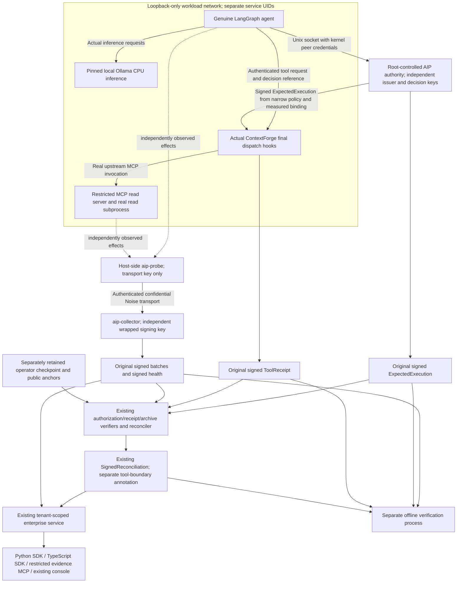

# Same-run execution assurance integration

The integration branch combines PR #6 at `65b6ff7fdad5ae70546a57216a497399091c7dc7`
and PR #7 at `bd15b8e627e5ef67ba259559ed81feb6894cde48`. Their common ancestor
is `f025a57911f7daf473cdfdcbf98d2f911df2534e`. Merge revision
`e3aa195def7524d6ec84d37a934beebe18b6c794` contains both sets of changes.
The subsequent integration wrappers reuse the existing signed record formats.

The implemented first-run topology uses one disposable Linux VM. Different OS
accounts and private directories isolate the model, agent, gateway and tool
from authority, collector and reconciler keys. All still trust the VM kernel,
host root and GitHub administration. Separate institutional custody remains a
separate acceptance gate. The enterprise two-host installer retains its stricter
separation requirement.

`aip_mcp_gateway::assurance` joins original records under public anchors loaded
outside the submitted bundle. It invokes the existing authorization verifier,
`verify_tool_receipt`, archive verifier, `reconcile_expectation` and
`compare_tool_boundary`. It verifies optional original signed reconciliation
against the configured reconciler key and exact canonical recomputation.
It introduces no replacement signature or execution-verdict protocol.

The authority measures the actual ready agent process through host procfs,
checks binding stability, verifies issuer scope and checks an exact canonical
tool/resource/parameter policy. The agent supplies neither PID nor keys to the
Unix broker. The gateway independently checks the stored signed authorization
against its authenticated principal, actual received parameters and timestamp.
A random correlation ID cannot satisfy this path.

The same-run API stores the original bundle bytes and reevaluates them under
server-configured tenant/agent anchors and retained archive digests. Reader
credentials cannot submit or retrieve raw bundles. Existing evidence MCP tools
expose bounded metadata, evaluations and verified verdicts, with no additional
signing, shell, export or observer-control privilege.

The kernel cannot directly establish `ghost.tool.invoke.v1` business semantics
or in-process logical-agent identity. A truthful result may have verified
request-document agreement and a kernel `CannotProve` finding. File-write,
process and network records retain their individual process-instance bindings;
a tool-server child is not relabeled as the agent interpreter. A read-only
SQLite result is tool testimony and inspectable test output; fanotify does not
supply a file-read proof. See [SECURITY_ACCEPTANCE.md](SECURITY_ACCEPTANCE.md).
