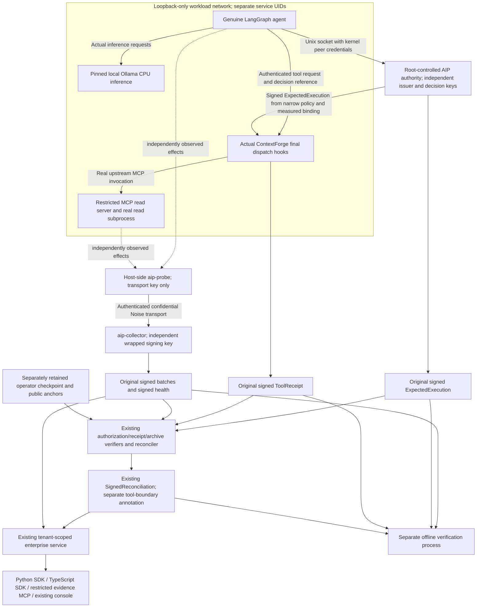

# Same-run execution assurance integration

The integration branch combines PR #6 at `65b6ff7fdad5ae70546a57216a497399091c7dc7`
and PR #7 at `bd15b8e627e5ef67ba259559ed81feb6894cde48`. Their common ancestor
is `f025a57911f7daf473cdfdcbf98d2f911df2534e`. Merge revision
`e3aa195def7524d6ec84d37a934beebe18b6c794` contains both sets of changes.
The subsequent integration wrappers reuse the existing signed record formats.

The implemented first-run topology uses one disposable Linux VM. Different OS
accounts and private directories isolate the model, agent, gateway and tool
from authority, collector and reconciler keys. All still trust the VM kernel,
host root and GitHub administration. Separate institutional custody remains a
separate acceptance gate. The enterprise two-host installer retains its stricter
separation requirement.

`aip_mcp_gateway::assurance` joins original records under public anchors loaded
outside the submitted bundle. It invokes the existing authorization verifier,
`verify_tool_receipt`, archive verifier, `reconcile_expectation` and
`compare_tool_boundary`. It verifies optional original signed reconciliation
against the configured reconciler key and exact canonical recomputation.
It introduces no replacement signature or execution-verdict protocol.

The authority measures the actual ready agent process through host procfs,
checks binding stability, verifies issuer scope and checks an exact canonical
tool/resource/parameter policy. The agent supplies neither PID nor keys to the
Unix broker. The gateway independently checks the stored signed authorization
against its authenticated principal, actual received parameters and timestamp.
A random correlation ID cannot satisfy this path.

The same-run API stores the original bundle bytes and reevaluates them under
server-configured tenant/agent anchors and retained archive digests. Reader
credentials cannot submit or retrieve raw bundles. Existing evidence MCP tools
expose bounded metadata, evaluations and verified verdicts, with no additional
signing, shell, export or observer-control privilege.

The kernel cannot directly establish `ghost.tool.invoke.v1` business semantics
or in-process logical-agent identity. A truthful result may have verified
request-document agreement and a kernel `CannotProve` finding. File-write,
process and network records retain their individual process-instance bindings;
a tool-server child is not relabeled as the agent interpreter. A read-only
SQLite result is tool testimony and inspectable test output; fanotify does not
supply a file-read proof. See [SECURITY_ACCEPTANCE.md](SECURITY_ACCEPTANCE.md).

## Artifact origins and trust limits

This register describes evidence types, not passing execution results. Retain
the original signed bytes alongside separate verification and presentation
annotations; an API response or screenshot does not change a record's authority.

| Artifact | Origin and authority | Trust limit |
| --- | --- | --- |
| Original `ExpectedExecution` | Independent AIP decision authority evaluates scope and signs the decision under separately provisioned public anchors | Authorization and measured process binding do not prove that execution occurred; the hosted authority still trusts host root/kernel |
| Original `SignedToolReceipt` | ContextForge gateway signs the actual request parameters, decision reference and dispatch disposition | A valid receipt proves gateway testimony; `Forwarded` does not establish tool success or a business outcome |
| Original signed observation batches | Collector signs observations received from an enrolled authenticated probe; the probe reports kernel observations and binding measurements | Collector signature validity does not independently prove probe/kernel honesty, complete capture, logical-agent attribution or business semantics; evaluate sensor integrity, loss and coverage separately |
| Original signed health records | Collector attests its retained chain head, observation interval and reported health/integrity state | Use the applicable final signed health and explicit coverage window; historical `Active` state cannot fill gaps or replace a later degraded state |
| Linux audit export and corroboration | Root-controlled export of a separate Linux audit source, compared with probe records | The audit log/export is unsigned supporting material on the same kernel; agreement is a crosscheck, not separate administrative custody |
| Public anchors and archive checkpoint | Operator retains approved public identities and archive hashes outside the submitted bundle | These constrain accepted signatures and detect checkpointed truncation; CI/operator storage remains in the shared administrative domain and does not establish institutional custody |
| Original `SignedReconciliation` | Configured reconciler signs its result; verification also requires canonical recomputation from the retained original records and configured trust | A valid reconciler signature alone cannot upgrade missing coverage, unsupported action evidence or unproven attribution |
| Agent events, model responses and tool output | Agent/model/tool application reports, retained with their stated source authority | These are inspectable supporting testimony, not independent kernel observations, signed authorization, delegation proof or authoritative bank outcome evidence |
| API, SDK and MCP results | Existing service reevaluates original records; clients retrieve the retained bytes or permitted metadata/verdict | Transport and retrieval checks preserve the original source authorities; client success does not establish fresh observation coverage |
| Console/browser captures and validation reports | Controller captures the displayed run and records client/negative-test outcomes | These are presentation/test annotations; inspect the underlying original records and exact run provenance |
| Performance and runtime/model manifests | Controller records process/cgroup counters, elapsed times and verified distribution/model hashes | These annotations do not establish independent custody, reproducible binary build provenance or causal observer overhead without a matched baseline |

Unsupported logical attribution, business effects and intervals without
adequate coverage remain explicitly unknown or `CannotProve`. The shared-host
profile cannot establish resistance to compromise of its kernel or root
administrator, even when its signing keys belong to distinct processes.

## Executed connection status

At `d6eb35e4de11fbec10953e5ed00bd934f1cc02d7`, workflow40847427090 actually
executed the authorization, gateway, tool, kernel/probe, authenticated transport,
collector signing, canonical reconciliation, tenant API, both SDKs, restricted
MCP, existing console and separate offline-verifier connections for one genuine
model workload. It also repeated the client path over genuine interruption and
fresh recovery profiles. The off-host/separate-administration arrow remains
incomplete: the executed collector is a separate process/key on the same kernel
under shared root/GitHub administration. No separate-host custody is implied by
that software-path success.
