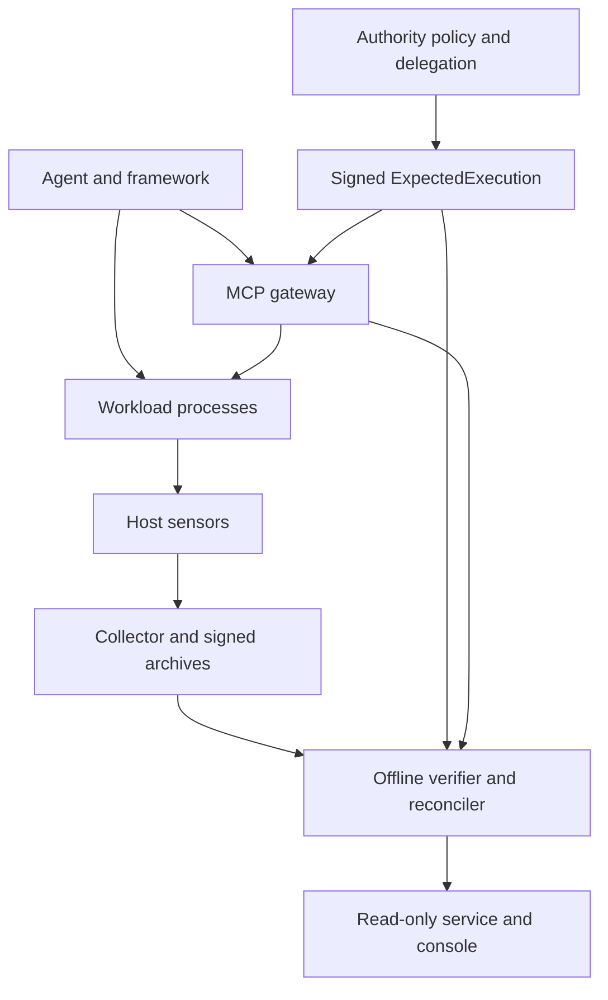

# P0-057 architecture and trust boundaries

Implementation checkpoint: `5be83a87bec680d26510c2be93e66fdfda008b1e`.
The existing native pipeline is retained. The only production change in this
checkpoint is coherent executable measurement/cache refusal in `ProcfsProbe`.

An arrow indicates a data path, not a proven attribution edge. Framework logs
and OTel spans are application claims. The gateway attests what it received and
dispatched. The host sensor samples kernel facts and depends on that kernel.
The collector authenticates/signs submitted observations; it cannot make a
compromised sensor honest. The verifier requires externally provisioned anchors
and completeness checkpoints. Separate keys do not prove separate administration.

Existing modules own their decisions: `aip-authorize` verifies institutional
authority inputs; `aip-observe` and `aip-probe` measure; `aip-collector` authenticates
and seals; `aip-observe-verify` checks archive integrity/continuity;
`aip-reconcile` compares supported actions and coverage; the MCP gateway's
`assurance` module composes these results without upgrading an unavailable tool
effect. The API, SDK, evidence MCP server and console consume those results.

## Executable measurement change

Open `/proc/PID/exe` once for hashing and obtain its metadata and context path
through that descriptor. Cache identity includes process start ticks, device,
inode, size, mtime, ctime and path. After hashing or a cache hit, compare the
opened file with the current executable and recheck process start/placement.
Refuse observed changes and discard the cached entry. The outer pidfd liveness
check remains. No observation schema, signature, trust anchor, coverage threshold
or reconciliation verdict was relaxed.

This detects sampled changes. It is not an atomic kernel snapshot, proof of
event-time image identity, code-memory attestation, or proof against a malicious
kernel/filesystem. Exec-away-and-back between samples remains possible. Missing
namespace/cgroup facts remain unavailable. The core's self-report collection
API remains a self-report; only its streaming hash implementation is shared.

Linux semantics reviewed: [proc_pid_exe](https://man7.org/linux/man-pages/man5/proc_pid_exe.5.html),
[open](https://man7.org/linux/man-pages/man2/open.2.html),
[stat/fstat](https://man7.org/linux/man-pages/man2/stat.2.html).
The descriptor/check strategy is an engineering inference from those semantics,
validated for the retained cold/warm-cache exec interleavings, not all races.
