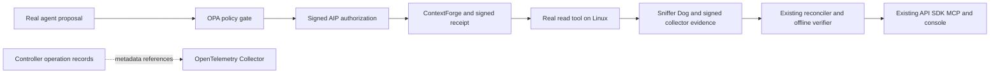

# Executed governance integration — 2 November 2026

**Genuine local-isolation integration and separate offline verification PASS.**
Overall institutional/production acceptance remains partial. PRs #6, #7 and #8
remain drafts; two security scanners still fail.

Runtime source: `3e6c1794000fa23006ef623722e37700e49582b7`.
[Actual workflow 41432473155](https://github.com/richardrich999888-rgb/AIP-agent-identity-protocol-/actions/runs/41432473155)
executed a real LangGraph/local-model synthetic-loan read through the existing
AIP authority, ContextForge, tool server, Sniffer Dog, collector, reconciler,
enterprise API, both SDKs, restricted MCP client and browser console. OPA 1.22.0
was an additional gate before the unchanged Rust signer. OpenTelemetry SDK
1.45.2 and Collector Contrib 0.164.0 received only the actual controller's
approved trace metadata after workload cleanup.



| Actual profile | Model response events | Signed batches / kernel events / health | Independent six-sensor task coverage | OPA links / final six-phase Collector files / original client checks |
| --- | --- | --- | --- | --- |
| Positive | 2 | 42 / 1,268 / 4 | PASS | PASS / PASS / 10 PASS |
| Observer interrupted | 2 | 16 / 424 / 4 | Correctly unavailable | PASS / PASS / 10 PASS |
| Fresh recovery | 2 | 42 / 1,249 / 3 | PASS, new capture and keys | PASS / PASS / 10 PASS |

The workflow's original coverage gate requests three mechanisms; the separate
post-signature replay explicitly checked all six for each actual interval.
Positive/recovery have two exact-instance exec events, one bound file event
and eight bound TCP sends each. These events do not reveal file contents or
establish URL, payload, loan approval or business-effect causality.

All three original archives, public anchors/checkpoints, authorizations,
Forwarded/Refused receipts and signed reconciliations verify separately.
OPA input/data/proposal/policy/output hashes and the link to each actual signed
decision/expectation file match. Every stopped Collector file passes strict
nonce, trace, parent, phase, timestamp, attribute and byte-hash checks. The
missing-assets negative refused execution before agent, authority or archive
creation and retained its structured failure with successful cleanup.

Canonical positive/recovery kernel findings remain
`CannotProve/ActionEvidenceUnavailable`, with full-authorization-window
`WindowNotCovered`; the gateway parameter comparison is `Agrees`. Interruption
correctly remains `NoReference`/`CannotProve/WindowNotCovered`. No unsupported
application action or long authorization window was promoted to kernel proof.
OPA audits and traces remain unsigned supporting application records.

The [complete unchanged original ZIP](genuine-3e6c179/original-artifact.zip)
is 1,192,822 bytes, has 154 public members and passes full local CRC/SHA checks.
SHA-256: `48ccc9525cade552b8eb28874e0c786b96a4b00024defd8b17e7cd9fbab6a505`.
The [portable original/replay index](genuine-3e6c179/preservation-index.json)
links every original member and separate verification receipt. The
[component proof](components-3e6c179/source-index.json) has 21 real-framework
controls passing with zero skips on Mac and Linux. Component peer/timestamp
fixtures are not actual agent evidence; see [scope](SCOPE.md).

The [exact-source CI registry](ci-3e6c179/registry.json) records **18 checks:
16 PASS / 2 FAIL**; including the separate genuine core and guarded task gives
20 jobs: 17 PASS / 2 FAIL / 1 expected skip. Debug units/integrations: 3,268
passed, 7 ignored; release: 3,270 passed, 5 ignored. Each additionally has 2
passed/2 ignored doctests. These are per-profile repetitions, not unique totals.
RED records 43 runnable cases, 2 notes and 10 blocked cases. Gitleaks' 217
findings and Trivy's four HIGH host-privilege findings remain failed scans;
the result-object sets match the previously reviewed historical records.
No new scanner exception or verification waiver was added. Both Cargo-audit
workflows retain the inherited `RUSTSEC-2026-0097` exception, documented in
`deny.toml`; their pass status is not an unqualified security clearance.

Existing API/SDK/MCP/console checks cover the AIP bundle and verdict. OPA
and Collector metadata is reviewed through the workflow artifacts/offline
records; no new governance-metadata API endpoint or console view is implemented.

## Measured controller timings

| Profile | Actual task window ms | Evaluate-and-sign CLI ms | Offline evaluate CLI ms |
| --- | --- | --- | --- |
| `same-run` | 16356 | 705.314 | 706.023 |
| `same-run-interruption` | 15556 | 297.232 | 299.021 |
| `same-run-recovery` | 15760 | 677.362 | 687.296 |

These are original controller wall times, including process startup and all
verification work. They are not isolated reconciler CPU benchmarks, matched
observed/unobserved overhead, production throughput or service-level promises.

## Portable replay of the retained governance run

The new `validation/enterprise/replay_retained_governance.py` launcher accepts
explicit package, repository, prepared OPA executable and fresh output paths.
It supports this exact reviewed source3e6c179/run41432473155 dataset, rather
than accepting arbitrary replay programs from an evidence sender. It pins the
package inventory, complete original ZIP, member manifest and all three frozen
scripts; checks every original member's safe path, regular type, size, CRC and
SHA; and loads only the pinned public modules. The original scripts and signed
evidence are unchanged. Only known path assignments in new derived copies are
replaced, with exact-once transformations and before/after hashes retained.

Prepare the four trusted Rust tools from a checkout whose Rust/Cargo sources
match source3e6c179. For a shallow checkout, fetch reference commit
`3e6c1794000fa23006ef623722e37700e49582b7` while networking is available.
This build phase may retrieve Cargo dependencies:

```sh
cargo build --locked -p aip-observe-verify -p aip-corroborate -p aip-mcp-gateway \
  --bin aip-observe-verify --bin aip-corroborate \
  --bin aip-tool-receipt --bin aip-execution-assurance
```

Prepare the platform-pinned OPA executable separately while networking is
available. This command downloads only the public pinned OPA asset/license;
it does not prepare the SDK or Collector:

```sh
python3.12 integrations/governance/opa.py prepare --root /absolute/prepared-opa
```

Then disconnect networking or use the offline validation environment. On
Linux amd64, run from the trusted checkout:

```sh
python3.12 validation/enterprise/replay_retained_governance.py \
  --package "$(pwd -P)/validation/enterprise/results/GOVERNANCE_20261102/genuine-3e6c179" \
  --repo "$(pwd -P)" \
  --opa /absolute/prepared-opa/opa-1.22.0-linux_amd64 \
  --out /absolute/fresh-governance-replay
```

For Darwin arm64, select `opa-1.22.0-darwin_arm64` instead. The output parent
must exist; the output directory itself must not exist. Input/output symlinks,
modified or unexpected package files, unsafe/duplicate ZIP members and missing
or changed assets are refused. The operator explicitly trusts the local Rust
executables and host; source comparisons plus executable hashes provide
provenance rather than build attestation. No SDK, Collector, agent, model or
network service is required during verification. OPA executes locally against
the original root-controller proposal/context; it does not sign authorization.

Inspect `portable-replay-result.json`, `path-transformations.json`, each frozen
script's stdout/stderr and the fresh `independent-offline/` reports. `PASS`
means all three unchanged replay scripts succeeded. It does not mean an
interrupted interval became covered: positive/recovery have six-sensor task
coverage; interruption correctly remains uncovered/NoReference. Canonical
kernel `CannotProve` findings, same-artifact anchor/checkpoint custody, and
unsigned controller OPA/telemetry limits remain. Legacy frozen field names
mentioning Mac/Darwin are preserved; the launcher/new receipts record the
actual host and verified platform asset.

Validation of the launcher: actual complete three-profile replay passed with
the current four compiled Rust tools and pinned Darwin OPA, including an output
path containing spaces and apostrophes. Fifteen focused controls passed,
covering pinned-file changes, late script substitution, unsafe/duplicate ZIP
members, symlink ancestry, unexpected import payloads, wrong OPA, existing
output refusal, path-only reversible transforms and primary failure retention.
These controls include synthetic malformed packages; they are not additional
genuine agent runs. Original retained package bytes and previous receipts are
unchanged.

## Supported pitch and exact open gates

VANIAN connects open-source policy and operational tracing to signed AI-agent
execution evidence. Policy permission, supported observed activity, gateway
request agreement, coverage and business outcomes retain separate meanings.
The policy scope here is a synthetic read-only action; fairness, general model
quality and institutional risk-management qualification are not established.

A separately administered collector Linux host/trust domain, independent
signing-key/storage custody and institution-approved enrollment/public anchors
are still required. One shared runner administrator/kernel cannot prove that
custody. A clean workload-host installation must qualify the full fanotify
installer/capabilities/mount visibility and actual startup/restart/continuity,
backup/recovery and retained-data uninstall. Logical delegation, concurrent
swarms, soak/loss and matched overhead, external assessment, production identity,
storage operations and authenticated remote telemetry remain unvalidated.
Remote model access, if selected, requires approved restricted secret/configuration
names, expiry, allowlisted endpoints and a tested hard spending cap. The
executed public local-model route needs no SSH host or paid API credential.

[Other real-agent results](../OPEN_SOURCE_AGENTS_20261101/REPORT.md) remain
separate: Agent Zero executed the invoice task but failed its business oracle;
its signed capture passes integrity/coverage. DeerFlow/OpenHands native
capabilities failed and their business tasks did not start. No all-framework
business, genuine GitHub patch, swarm, customer, regulatory or production
acceptance is claimed.
